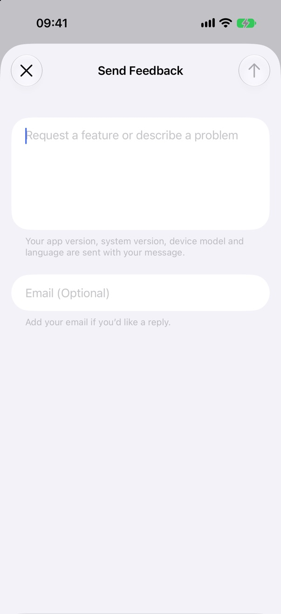
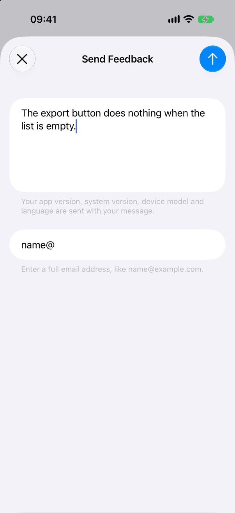
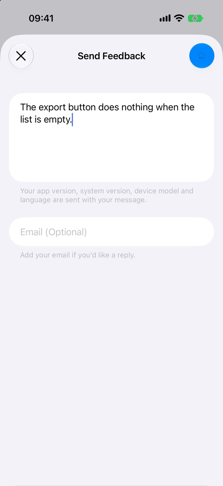
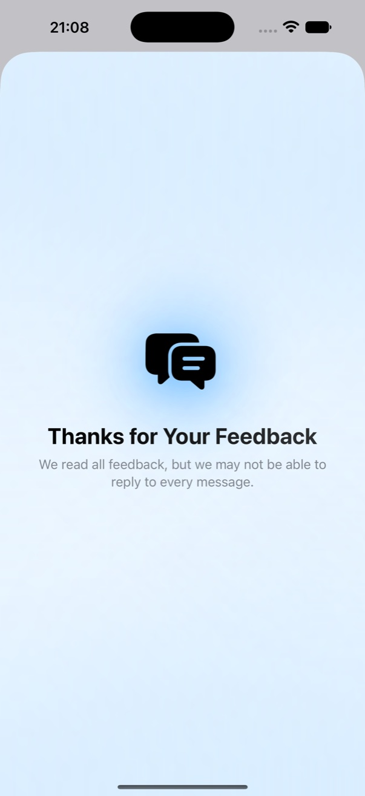
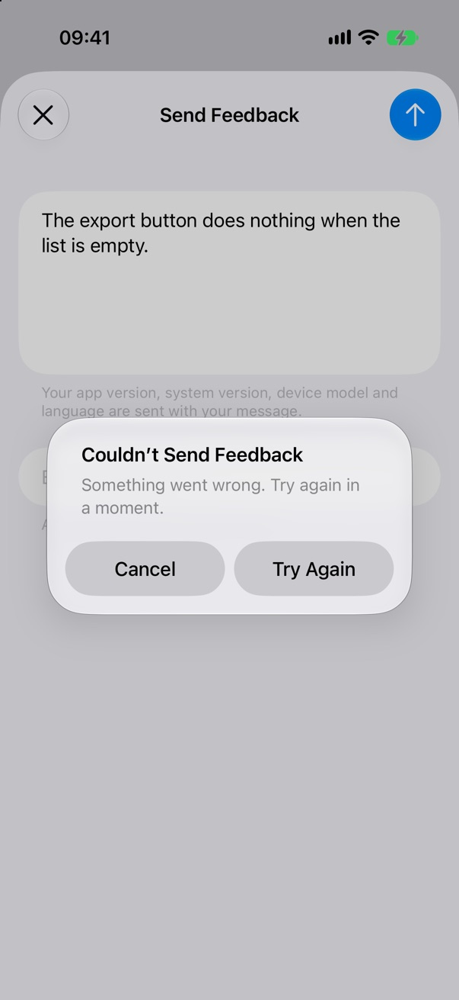
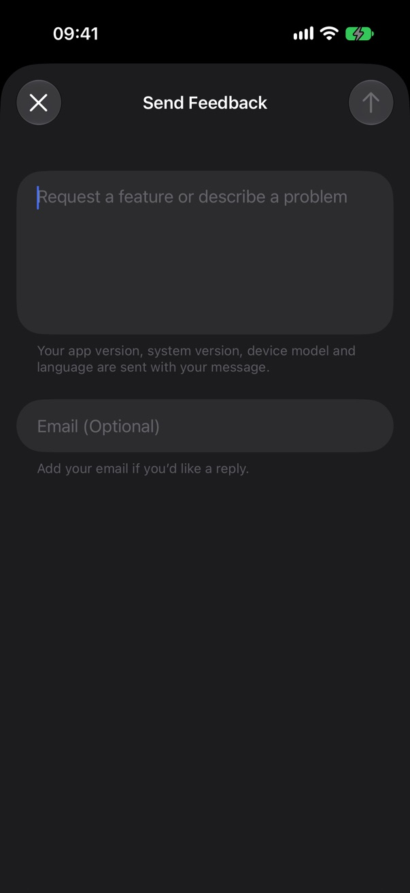
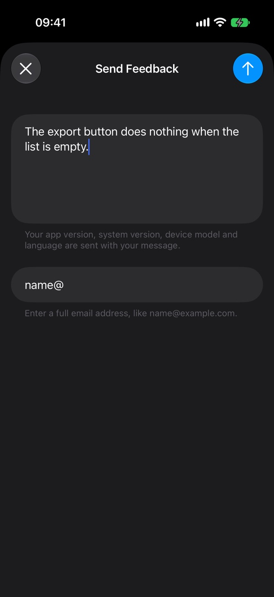
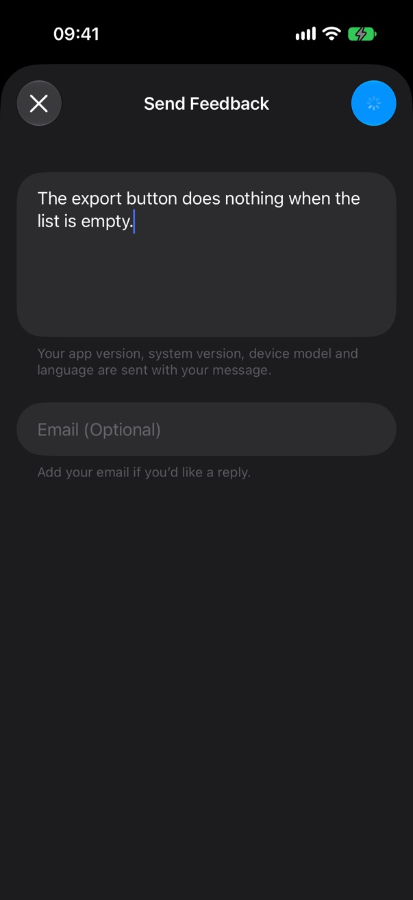
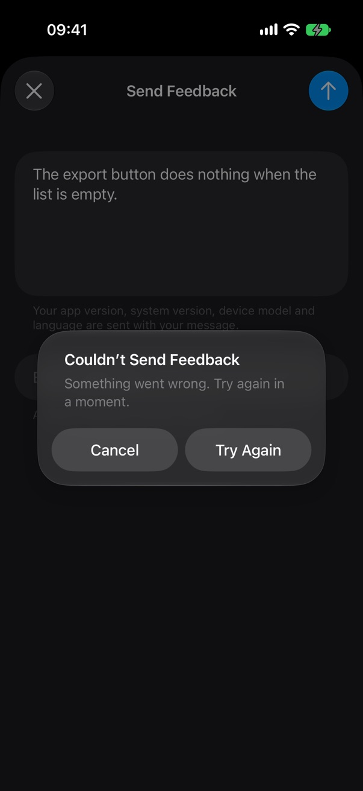

# FeedbackKit

[](https://github.com/hksw-io/feedbackkit/actions/workflows/ci.yml)

A SwiftUI feedback form for iOS and macOS that replaces Mail. People write a message, optionally add
an email address, and tap Send; the form shows the send, says thanks, and closes.

HK Softworks apps send straight to the shared HK Softworks feedback service, signed with App Attest
and the app's AppTransaction, so the service only accepts feedback from a genuine copy of the app. The
service is private, so any other app sends to its own backend through a `FeedbackSender`.

The kit owns the form, the diagnostics and the request flow. The app passes its copy and where to send.
No dependencies.

## Preview

<p>
  
  
  
</p>
<p>
  
  
  
</p>

Empty, typed, an incomplete email address, sending, sent, and a failed send. Send morphs to a spinner
and then a checkmark, and the form fades to a thank-you screen with your app icon, which closes by itself
after about 5 seconds or when tapped.

<p>
  
  
  
</p>
<p>
  
  
  
</p>

The same states in dark mode.

## Requirements

- iOS 26+ / macOS 26+
- Swift 6.2+

To send to the HK Softworks feedback service, also:

- The App Attest capability (`com.apple.developer.devicecheck.appattest-environment`, `production` for
  TestFlight and the App Store)
- The app's bundle ID and App Apple ID in the feedback service's app list

Devices without App Attest can't send to the service, and there is no Mail fallback: the form says so
plainly and disables Send.

## Installation

```swift
.package(url: "https://github.com/hksw-io/feedbackkit.git", from: "1.0.0")
```

Or in Xcode: **File > Add Package Dependencies**, enter the URL above, and choose **Up to Next Major Version** from `1.0.0`.

## Usage

Present `FeedbackView` in a sheet on iOS, and in a sheet or a window on macOS. With the HK Softworks
feedback service:

```swift
import FeedbackKit
import SwiftUI

.sheet(isPresented: $showsFeedback) {
    FeedbackView(
        serviceURL: URL(string: "https://feedback.example.com")!,
        icon: Image("AppIconImage"),
        strings: feedbackText,
        onDismiss: { showsFeedback = false })
}
```

`serviceURL` is the service's base URL, the same for App Store, TestFlight and development builds.
`appID`, sent as `X-Feedback-App`, defaults to `Bundle.main.bundleIdentifier`. Forward your app's
haptics preference as `hapticsEnabled`.

For Report a Problem, change the title and prompt and pass what happened as `context`, up to 10 lines
of 500 characters:

```swift
FeedbackView(
    serviceURL: feedbackURL,
    icon: Image("AppIconImage"),
    strings: feedbackText,
    title: .problemTitle,
    prompt: .problemPrompt,
    context: ["Action: Couldn’t Save Card", "Error: card.save"],
    onDismiss: { report = nil })
```

`title` is `.feedbackTitle` or `.problemTitle`. `prompt` is `.feedbackPrompt`, `.problemPrompt`, or
`.contentPrompt` for a report about one piece of content.

`onDismiss` runs when the person closes an empty form, confirms Discard Changes, or when the thank-you
screen after a successful send ends: after about 5 seconds, or sooner if the person taps it. On iOS a swipe-down closes an empty sheet without calling it; with a draft, the swipe
asks to discard first. On macOS the form is 480 points wide, Esc is Cancel, Send is the default button, and
in a window its title comes from `title`. UI tests can find the form by the accessibility identifier
`feedback.form`.

### The copy

The kit ships no strings. `strings` returns your app's text for every `FeedbackString`, so the form
localizes with the rest of your app. An exhaustive `switch` makes the compiler flag any case you miss,
including cases a later release adds. This English copy is a starting point:

```swift
import FeedbackKit

func feedbackText(_ string: FeedbackString) -> String {
    switch string {
    case .feedbackTitle: String(localized: "Send Feedback")
    case .problemTitle: String(localized: "Report a Problem")
    case .feedbackPrompt: String(localized: "Request a feature or describe a problem")
    case .problemPrompt: String(localized: "What happened?")
    case .contentPrompt: String(localized: "What’s wrong with this card?")
    case .messageLabel: String(localized: "Message")
    case .diagnosticsFooter:
        String(localized: "Your app version, system version, device model and language are sent with your message.")
    case .thanks: String(localized: "Thanks for Your Feedback")
    case .thanksRead: String(localized: "We read all feedback.")
    case .thanksMayReply: String(localized: "We read all feedback, but we may not be able to reply to every message.")
    case .unsupported: String(localized: "This device can’t send feedback.")
    case .emailLabel: String(localized: "Email")
    case .emailPlaceholder: String(localized: "Email (Optional)")
    case .emailFooter: String(localized: "Add your email if you’d like a reply.")
    case .emailInvalid: String(localized: "Enter a full email address, like name@example.com.")
    case .send: String(localized: "Send")
    case .cancel: String(localized: "Cancel")
    case .complete: String(localized: "Complete")
    case .failedTitle: String(localized: "Couldn’t Send Feedback")
    case .failedMessage: String(localized: "Something went wrong. Try again in a moment.")
    case .offlineMessage: String(localized: "You’re offline. Connect to the internet, then try again.")
    case .tryAgain: String(localized: "Try Again")
    case .ok: String(localized: "OK")
    case .discardTitle: String(localized: "Discard Changes?")
    case .discardMessage: String(localized: "Your changes won’t be saved.")
    case .discard: String(localized: "Discard Changes")
    case .keepEditing: String(localized: "Keep Editing")
    }
}
```

`.messageLabel` and `.emailLabel` are the fields' VoiceOver labels; `.complete` labels the checkmark.
`.thanks` heads the thank-you screen, over `.thanksRead` when the person left no address, or `.thanksMayReply`
when they did, so nobody who can't get a reply is told about replies.
`.unsupported` is the footer, and the alert message, on a device that can't send.

### Your own backend

Pass a `FeedbackSender` instead of a service URL, and the form sends through it. `FeedbackSubmission`
is `Encodable`, so posting it as JSON takes a few lines:

```swift
struct BackendSender: FeedbackSender {
    let endpoint: URL

    var isSupported: Bool { true }

    func send(_ submission: FeedbackSubmission) async throws(FeedbackError) {
        var request = URLRequest(url: self.endpoint)
        request.httpMethod = "POST"
        request.setValue("application/json", forHTTPHeaderField: "Content-Type")
        do {
            request.httpBody = try JSONEncoder().encode(submission)
            let (_, response) = try await URLSession.shared.data(for: request)
            guard let status = (response as? HTTPURLResponse)?.statusCode, (200 ..< 300).contains(status) else {
                throw FeedbackError.failed
            }
        } catch let error as URLError where error.code == .notConnectedToInternet {
            throw .offline
        } catch {
            throw .failed
        }
    }
}

FeedbackView(
    sender: BackendSender(endpoint: URL(string: "https://example.com/feedback")!),
    icon: Image("AppIconImage"),
    strings: feedbackText,
    onDismiss: { showsFeedback = false })
```

Throw `.offline` or `.failed` to show the failure alert with Try Again, or `.unsupported` for the
cannot-send state. The body is the same JSON the HK Softworks service takes: `message`, `email` (left out
when empty), `appVersion`, `system`, `device`, `language` and `context`.

### Previews, demos and UI tests

App Attest is not available in the Simulator, so there the service-backed form shows `.unsupported`.
To drive it anyway, pass a fake sender:

```swift
struct PreviewSender: FeedbackSender {
    var isSupported: Bool { true }

    func send(_: FeedbackSubmission) async throws(FeedbackError) {}
}

FeedbackView(sender: PreviewSender(), icon: Image("AppIconImage"), strings: feedbackText, onDismiss: {})
```

The demo app in `Demo/` does this with a picker for each outcome.

## Behavior

- Send is enabled whenever the trimmed message is non-empty, up to 5,000 characters.
- The email address is optional. Its error appears when the field loses focus or Send is tapped with an
  incomplete address, and clears as soon as the address is complete. Send with an incomplete address
  shows the error, plays the error haptic and sends nothing.
- On iOS the Discard Changes confirmation comes from the close button, and a swipe-down on a draft asks
  too. On macOS it comes from Cancel.
- A failed send keeps the draft and offers Try Again. Being offline has its own message.
- A device without App Attest, or one whose App Attest keeps failing, says it can't send feedback and
  disables Send.

## The HK Softworks feedback service

With a service URL, the kit implements wire contract v1 of the HK Softworks feedback service. The
service isn't open source; this summary is for reviewing what the kit sends. For each send:

1. Every request carries `X-Feedback-App`, `X-Feedback-App-Transaction`
   (`AppTransaction.shared.jwsRepresentation`) and an `Idempotency-Key`.
2. Without a registered key, the kit generates an App Attest key, asks
   `POST /v1/app-attest/challenges` for a `registerKey` challenge, attests the key with the 32
   challenge bytes as the client data hash, and registers it with `POST /v1/app-attest/keys`.
3. It asks for a `submit` challenge bound to the SHA-256 of the exact body, builds the `HKF1` client
   data (the challenge, `POST`, `/v1/feedback`, the body's SHA-256, the `Idempotency-Key`, the
   AppTransaction's SHA-256 and the raw key ID, each with a 4-byte big-endian length), and sends
   `POST /v1/feedback` with the key ID, the challenge ID and the assertion over SHA-256 of that client
   data.

Binary values are base64url without padding. Recovery follows the contract:

- `428` with `app-attest-key-unregistered` registers the key again and resends, once.
- `401` with `app-attest-registration-challenge-rejected` asks for a new registration challenge, once.
- When DeviceCheck says a key is invalid, the kit generates one new key. A second invalid key means the
  device can't send.
- DeviceCheck's `serverUnavailable` is retried once after 2 seconds.
- A retry of the same message after a lost connection or a `5xx` reuses its `Idempotency-Key`, so the
  service can recognize it. Anything else starts a new one.
- `400`, `401`, `429` and `5xx` show the failure alert. No connection, a lost connection or a timeout
  shows the offline message.

## Privacy

- With the HK Softworks service, the service receives the message, the email address if one was entered, the app version and build,
  the system name and version, the hardware model identifier (`iPhone17,2`, `Mac15,3`;
  `SIMULATOR_MODEL_IDENTIFIER` in the Simulator), the language code (`sv`, not the region), any
  `context` lines, and the AppTransaction and App Attest proofs. The form's footer names every
  diagnostic it sends.
- The App Attest key never leaves the Secure Enclave. Its identifier and whether it is registered are
  kept in `UserDefaults.standard` under `<bundle ID>.feedbackKit.appAttestKeyID` and
  `<bundle ID>.feedbackKit.appAttestKeyRegistered`. A key restored from a backup onto another device is
  invalid there and is replaced on the next send.
- The kit logs to the app's own subsystem only when a send fails, with the HTTP status or the error
  domain and code. It never logs the message, the email address, JWS values, assertions or key IDs.
- For the App Store privacy label, feedback usually maps to User Content (Customer Support), Contact
  Info (Email Address, when one is given) and Diagnostics. The service also keeps an opaque per-install
  hash it derives from the AppTransaction. None of it is used for tracking.

## Accessibility

The fields have VoiceOver labels from `.messageLabel` and `.emailLabel`. VoiceOver announces the email error and the thanks. The form is a system `Form`, so it
follows Dynamic Type and light and dark mode. Reduce Motion swaps the button morph and footer changes
instantly, keeps every haptic, and keeps the thank-you screen's time on screen.

## Local development

```sh
swift test
```

`swift test` builds for macOS only. Build iOS too when touching platform-conditional code:

```sh
xcodebuild -scheme FeedbackKit -destination 'generic/platform=iOS Simulator' build
```

The demo app lives in `Demo/FeedbackKitDemo.xcodeproj` and uses a fake sender that answers after two
seconds. Launch arguments open the form straight away: `-demoSheet feedback` or `-demoSheet problem`,
and `-demoOutcome success`, `failure`, `offline` or `unsupported`. The README media was captured from
the iOS 27.2 Simulator (iPhone 17 Pro) with that demo.

## License

MIT. See [LICENSE](LICENSE).
